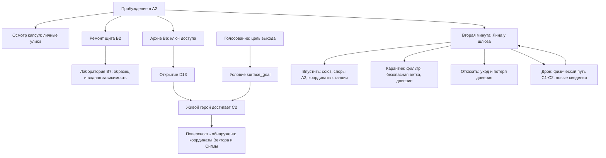

# Граф фактической первой сцены

Стрелки здесь описывают реализованные условия GameEngine/StoryDirector, а не автоматически доступную полную кампанию.

Герметизация B4 — отдельное решение первой/следующих минут: 2 детали, питание ≥30, личное согласие находящихся там героев; двери D03/D04/D10 SEALED, вентиляция B4 выключена, общий показатель вентиляции −8. На третьем цикле предупреждение о воздухе. Уже вышедшая биомасса остаётся.

Слоты действий разделены: назначить «выход» не означает телепортировать команду или выдать ключ. Архив читает присутствующий герой, дверь открывается рядом, C2 достигается физически. Найденные личные документы не превращаются в общие до SHARE.

Проверки есть для карантина Лины и независимой герметизации. Полные end-to-end развилки шести актов, reachability семи концовок и 12 базовых миссий ещё не реализованы. Следующие узлы — завершить акт I, затем Станция 47 с несколькими физическими маршрутами и сохраняемыми итогами.
