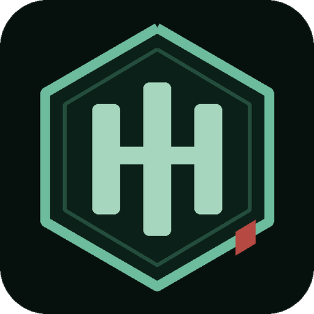
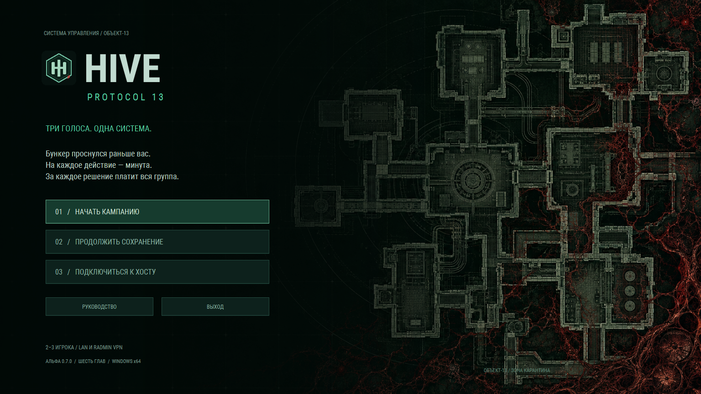
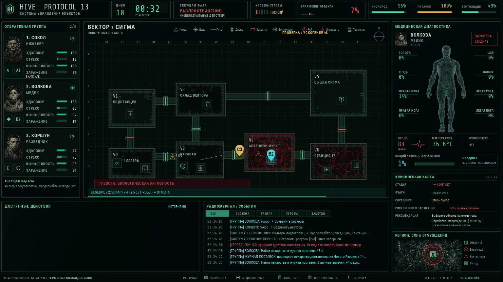
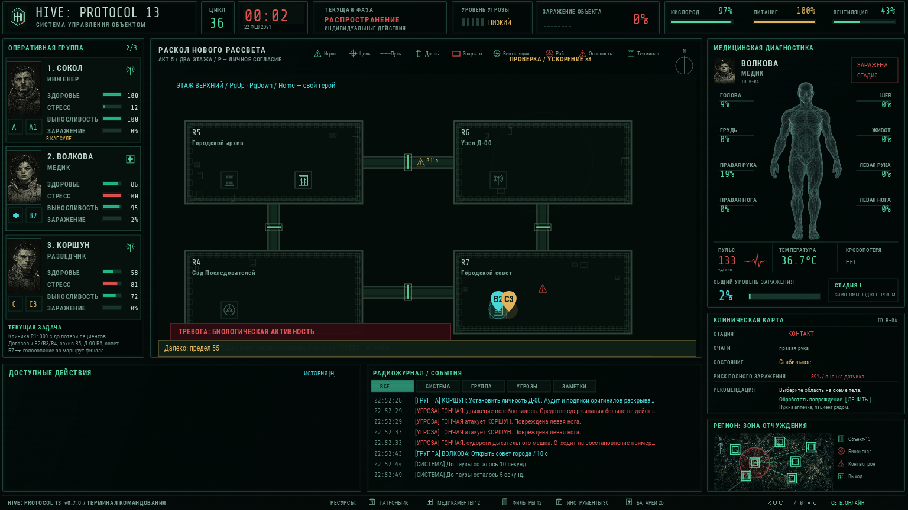

<div align="center">



# HIVE: PROTOCOL 13

**Три голоса. Одна система. Ни одной безопасной минуты.**

Кооперативный 2D-хоррор для **2–3 игроков** · **Windows x64** · **LAN / Radmin VPN**

[**Скачать игру**](https://github.com/Hollwestn/HIVE-Protocol13/releases/tag/v0.7.0) · [**Руководство с картинками**](docs/guide/index.html) · [**PDF-гайд**](docs/guide/guide.pdf) · [**Сообщить об ошибке**](https://github.com/Hollwestn/HIVE-Protocol13/issues)

**Публичная альфа 0.7.0** — шесть глав основной истории. Полный объём первоначального ТЗ ещё не завершён: [фактический статус](docs/STATUS.md).



</div>

Бункер проснулся раньше вас. За его стенами растёт колония, фильтрующая воду и переписывающая привычные правила жизни. Система предлагает решения. Архивы ей противоречат. Ваша группа должна понять, кому верить, кого спасать и какой ценой уходить.

На действия даётся минута. Затем мир останавливается, и каждый голосует сам. Но принятое решение ещё нужно выполнить: дойти до щитка, собрать образец, удержать клапан, вывести человека. Существа переживут любой ваш выстрел. Выигранные секунды — ваш главный ресурс.

## Что уже работает

| Система | Что делает игрок |
|---|---|
| Совместная игра | Выбирает инженера, медика или разведчика; подключается к настоящему TCP-серверу хоста. В паре третий герой остаётся в капсуле. |
| Минутные фазы | Двигается и работает 60 секунд, затем принимает решение отдельным голосом. Мир и дедлайны стоят на голосовании. |
| Живая карта | Открывает двери, ремонтирует питание, работает с предметами через ПКМ. Биомасса, шум и угрозы меняют обстановку. |
| Сдерживание | Использует дробовик, электрошокер, сигнальный пистолет, укрытия и баррикады. Оружие задерживает существ, они восстанавливаются и адаптируются. |
| Медицина | Лечит конкретные части тела, контролирует кровотечение и заражение, помогает товарищу рядом. |
| Эхо | После потери тела поддерживает группу камерами, отметками, громкоговорителем и обычными шлюзами при наличии связи и питания. |
| Сюжет | Принимает ресурсные и личные решения; видит последствия для людей, колонии и финала. |



Снимки сделаны в работающем клиенте. Жёлтая надпись об ускорении относится к проверочному запуску; обычная фаза длится реальную минуту. Карта и показатели строятся из состояния мира.

## Шесть глав, разные задачи

| Глава | Особенность |
|---|---|
| I · Объект-13 | Аварийное питание, исследования, водная колония и подготовка эвакуационной шахты. |
| II · Поверхность / Сигма | Караван, независимые доказательства и спасение учёного под отсчёт времени. |
| III · Гидроузел | Два этажа, затопление, короткое окно клапанов и экологический выбор. |
| IV · Эдем | Личные архивы, копии, разрешения на память и преследователь на лестнице. |
| V · Новый Рассвет | Клиника, фракции, противоречивые документы и совет перед финалом. |
| VI · Узел | Ограниченное время, разные физические операции для шести финальных маршрутов. |

«Исход», «Оплот», «Очищение», «Симбиоз», «Новый протокол» и «Истинное пробуждение» имеют разные предпосылки и последствия. Потеря всех полевых тел приводит к «Падению». Секретный маршрут требует трёх полных личных ключей; технический ключ спящего героя его не заменяет.

<details>
<summary><strong>Ещё один снимок: совет и сюжетные решения (спойлер)</strong></summary>



</details>

## Начать играть

1. Скачайте **Setup.exe** из [последнего выпуска](https://github.com/Hollwestn/HIVE-Protocol13/releases/tag/v0.7.0) и установите игру. Для запуска без установки есть **Portable.zip**: распакуйте целиком и откройте `HIVE-Protocol13.exe`. Java уже внутри.
2. Если вы в разных сетях, заранее подключитесь к одной сети Radmin VPN.
3. Хост выбирает «Начать кампанию», оставляет `0.0.0.0`, порт `27713`, выбирает персонажа и открывает лобби.
4. В лобби хост копирует свои адреса и передаёт другу подходящий IP общей LAN/VPN-сети, порт и отдельно пароль, если задан.
5. Друг выбирает «Подключиться к хосту», вводит эти данные и берёт другого персонажа. Хост выставляет 2 или 3 участника. Все нажимают «Готов», хост запускает кампанию.

Другу нужен адрес компьютера хоста в вашей общей сети. `0.0.0.0` и `127.0.0.1` для подключения с другого компьютера не подходят. Все игроки должны обновиться до одной версии: используется сетевой протокол 5.

**Важно для выхода:** открыть дверь, подготовить выход и эвакуироваться — отдельные операции. Каждый живой игрок выбирает выход сам через ПКМ по объекту. Для перехода между главами каждый подтверждает продолжение.

В меню есть кнопка **«Руководство»**: открывает офлайн-гайд с картинками и ссылкой на PDF. GitHub показывает HTML как исходный файл; для чтения скачайте PDF или откройте `docs/guide/index.html` локально.

## Управление

| Действие | Клавиша |
|---|---|
| Идти / бежать / скрытно | ЛКМ / Shift + ЛКМ / Ctrl + ЛКМ |
| Предмет, дверь, контакт | ПКМ |
| Отменить движение и работу | Пробел |
| Взаимодействия / сдерживание / инвентарь | F / K / I |
| Документы / история / голосование | J / H / V |
| Личные разрешения / терминал Эхо | P / E |
| Показать этаж / вернуть обзор | PgUp, PgDown / Home |

Просмотр другого этажа не перемещает тело. Используйте лестницу на карте.

## Сборка из исходников

Нужны Windows x64 и **JDK 25**. Maven Wrapper закреплён в репозитории, зависимости загрузятся при первой сборке.

```powershell
$env:JAVA_HOME = 'C:\path\to\jdk-25'
.\mvnw.cmd -B verify
.\tools\Run-Game.ps1
```

Для EXE/MSI дополнительно нужны WiX 3.x в PATH и Windows x64 JRE 25:

```powershell
.\tools\Build-Windows.ps1 -RuntimePath 'C:\path\to\jre-25' -BuildId 'my-build'
```

Скрипт включает значок, руководство, Java и лицензии зависимостей. Подробнее: [сборка Windows](BUILD_WINDOWS.md), [архитектура](ARCHITECTURE.md), [сетевой протокол](NETWORK_PROTOCOL.md), [сохранения](SAVE_FORMAT.md).

## Проверки и ограничения

[Отчёт 0.7.0](docs/QA_0_7_0_RU.md) различает автоматические проверки, сквозные TCP-прохождения, проигранные попытки и непроверенное. Ускоренное прохождение не подтверждает длительность 6–10 часов. Локальный сетевой тест не заменяет трёх физических компьютеров через VPN.

До полной приёмки остаются расширение набора существ (сейчас два поведения из восьми), полная библиотека событий, побочные социальные ветки, баланс и визуальная приёмка дополнительных экранов. [Подробный статус](docs/STATUS.md) сохраняет эти обязательства.

Графика меню, портреты и эмблема заменены собственными материалами; происхождение и запросы описаны в [ART_PROVENANCE](docs/ART_PROVENANCE.md). [Лицензии компонентов](ASSET_LICENSES.md). Открытая лицензия на собственный код и графику пока не назначена.

Сохранения, пароли, сетевые идентификаторы, журналы и исходные пользовательские референсы в репозиторий не входят. Установщик не подписан сертификатом.
